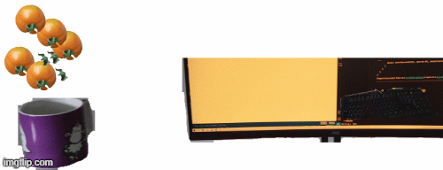
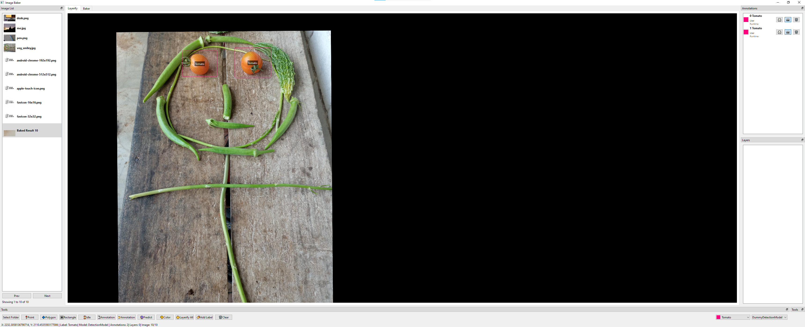
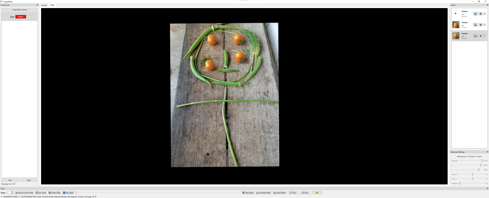
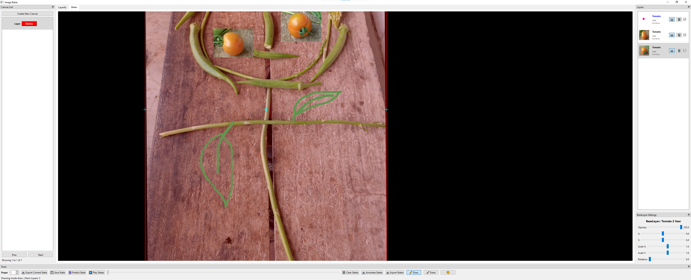
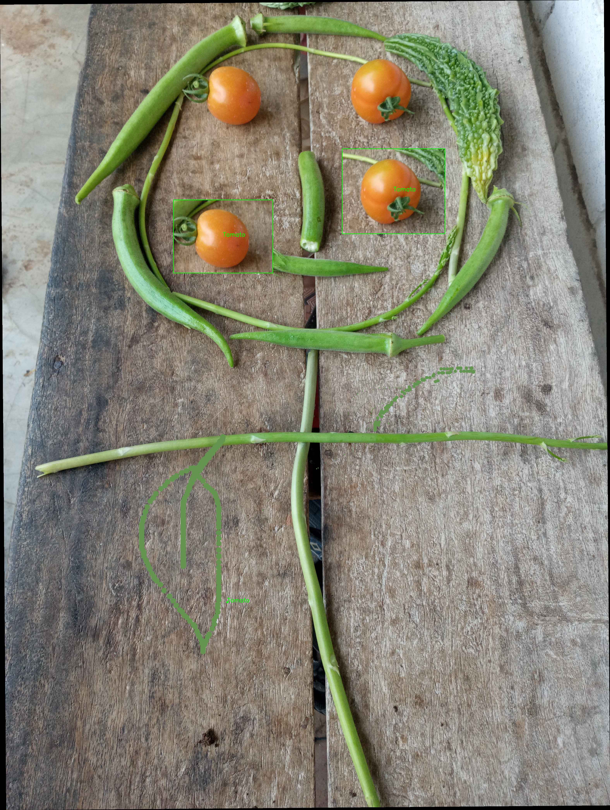

# Image-Baker

> [!NOTE]
> This project started as a fun personal project, but now I am actively **vibecoding** it!
> The most stable version for the Windows desktop app is [0.0.64](https://pypi.org/project/imagebaker/0.0.64/).
> If you are on Linux, macOS, or want a modern, cross-platform Label Studio-like experience with zero OS headaches, use the new standalone **Web Version** (`imagebaker web`).


<!--  -->
[](https://github.com/astral-sh/ruff)
[](https://pypi.org/project/imagebaker/)

<p align="center">
    
</p>


*An example of baked images. (Each object is a layer and an annotation will also be extracted for all layers.)*

Let's bake an image.

## Why is it relevant?

When training computer vision models (especially for detection and segmentation), labeling large amounts of data is crucial for better model performance. Often, the process involves multiple cycles of labeling, training, and evaluation. By generating multiple realistic labeled datasets from a single image, the time spent on labeling can be significantly reduced.

## What's up with the name?
The concept involves extracting portions of an image (e.g., objects of interest) using tools like polygons or models such as Segment Anything. These extractions are treated as layers, which can then be copied, pasted, and manipulated to create multiple instances of the desired object. By combining these layers step by step, a new labeled image with annotations in JSON format is created. The term "baking" refers to the process of merging these layers into a single cohesive image.

## Getting Started

ImageBaker can be used in four ways:

1. **🌐 Web Application** (`imagebaker web`) - Modern, responsive browser interface running across **Linux, macOS, and Windows** with Label Studio-inspired UX, draggable sidebars, model text prompt prediction, and real-time compositing.
2. **🖥️ Desktop Application** (`imagebaker gui`) - Native Qt desktop interface (Windows & Linux).
3. **⌨️ CLI Tool** (`imagebaker cli`) - Command-line interface for batch baking, configuration execution, and automation.
4. **🐍 Python Library & PyTorch Dataset** - Programmatic API with on-the-fly PyTorch dataset synthesis (`ImageBakerDataset`, `extract_baked_dataset`) and multi-format exports (`COCO`, `YOLO`, `DEFAULT`).

### Installation

#### Using PIP
This project is available on PyPI:

```bash
# Standard installation
pip install imagebaker

# Install with model extras
pip install "imagebaker[yolo]"       # Ultralytics YOLO detection & segmentation
pip install "imagebaker[rfdetr]"     # RF-DETR detection & instance segmentation
pip install "imagebaker[sam2]"       # Segment Anything 2 (SAM 2)
pip install "imagebaker[plugins]"    # Optional plugins (e.g. SmokeSim)
pip install "imagebaker[all]"        # All models & plugins combined
```

#### Developing Locally
Clone this repository and install it locally in editable mode:

```bash
git clone https://github.com/q-viper/image-baker.git
cd image-baker
python -m venv .venv
source .venv/bin/activate       # On Windows: .venv\Scripts\activate
pip install -e ".[all]"
```

### Usage

#### 🌐 Web Mode (Cross-Platform: Linux, macOS, Windows)
Launch the standalone browser-based application with Label Studio-inspired UX and zero OS dependencies:

```bash
# Launch web server and automatically open in your default browser
imagebaker web

# Specify custom host, port, project directory, and models file
imagebaker web --host 127.0.0.1 --port 8765 --project-dir . --models-file examples/loaded_models.py
```

#### 🖥️ Desktop GUI Mode
Launch the native Qt visual interface:

```bash
# Simple launch (default)
imagebaker

# Explicit GUI command with models
imagebaker gui --models-file examples/loaded_models.py
```

#### ⌨️ CLI Mode
Automate image composition and dataset baking from the command line:

```bash
# Simple composition
imagebaker cli bake simple bg.png fg.png -o output.png \
    --positions "0,0;100,100" --opacities "1.0,0.5"

# Config-based baking
imagebaker cli bake from-config config.py

# Get image info
imagebaker cli info image.png

# Check version
imagebaker cli version
```

#### 🐍 Python API & PyTorch Integration
Integrate ImageBaker into your training loops and pipelines:

```python
from imagebaker import ImageBaker, ImageBakerDataset, extract_baked_dataset, AnnotationFormat

# 1. Programmatic layer compositing and baking
baker = ImageBaker()
layer1 = baker.add_layer_from_file("background.png")
layer2 = baker.add_layer_from_file("foreground.png")
baker.set_layer_position(layer2, 100, 100)
baker.set_layer_opacity(layer2, 0.7)
result = baker.bake()
baker.save(result, "output.png")

# 2. PyTorch Dataset integration with on-the-fly sample synthesis
dataset = ImageBakerDataset(
    cache_dir=".imagebaker/cache",
    format=AnnotationFormat.COCO,  # AnnotationFormat.COCO, AnnotationFormat.YOLO, AnnotationFormat.DEFAULT
    split="train",
    split_ratio=(0.8, 0.1, 0.1),
    samples_per_epoch=1000,
    seed=42,
)
image_tensor, target = dataset[0]

# 3. Batch export cached baking sessions to disk
extract_baked_dataset(
    cache_dir=".imagebaker/cache",
    output_dir="./synthetic_dataset",
    annotation_format=AnnotationFormat.YOLO,
    train_ratio=0.8,
    val_ratio=0.1,
    test_ratio=0.1,
)
```

**📚 Documentation:**
- [Quick Start Guide](docs/QUICKSTART.md) - Get started in 5 minutes
- [Full API Reference](docs/api-usage.md) - Comprehensive documentation
- [Examples & Models](docs/examples.md) - Examples for YOLO, RF-DETR, SAM 2, and PyTorch dataset synthesis

## Features
- **Cross-Platform Annotation Studio**: Run either via the standalone Web interface (`imagebaker web`) or native desktop UI (`imagebaker gui`), featuring Label Studio-style interactive label chips, draggable sidebar splitters, and persistent user configuration.
- **AI Model Prediction & Text Prompts**: Run AI model inferences (YOLO, RF-DETR detection & instance segmentation, SAM 2) with optional text prompts (e.g. `"pedestrian"`, `"car"`) directly from the UI or code.
- **Layerifying**: Crop images based on annotations into reusable compositing layers with single-click or "Layerify All" batch processing.
- **Multi-Format Annotation Support**: Import and export annotations seamlessly across **COCO**, **YOLO**, and ImageBaker **Default** JSON formats using the `AnnotationFormat` enum.
- **Baking Timeline States**: Compose multiple layers with transforms (translation, scaling, rotation, edge width/opacity), interpolate states, randomize variations, and preview playback.
- **On-the-Fly PyTorch Dataset**: `ImageBakerDataset` inherits from `torch.utils.data.Dataset`, dynamically synthesizing realistic labeled training samples on the fly with reproducible train/val/test splits and layer constraints.
- **Layer Drawing & Erasing**: Draw and erase directly onto selected layers to add details or manual masks before baking.

### Shortcuts
* **Ctrl + C**: Copy selected annotation/layer.
* **Ctrl + V**: Paste copied annotation/layer in its parent image/layer if it is currently open.
* **Delete**: Delete selected annotation/layer.
* **Left Click**: Select an annotation/layer on mouse position.
* **Left Click + Drag**: Drag a selected annotation/layer.
* **Double Left Click**: When using polygon annotation, completes the polygon.
* **Right Click**: Unselect an annotation/layer. While annotating the polygon, undo the last point.
* **Ctrl + Mouse Wheel**: Zoom In/Out on the mouse position, i.e., resize the viewport.
* **Ctrl + Drag**: If done on the background, the viewport is panned.
* **Ctrl + S**: Save State on Baker Tab.
* **Ctrl + D**: Draw Mode on Baker Tab. Drawing can happen on a selected or main layer.
* **Ctrl + E**: Erase Mode on Baker Tab.
* **Ctrl + H**: Opens a help window.
* **Wheel**: Change the size of the drawing pointer.
* **Q**: Point mode on annotation.
* **W**: Polygon mode on annotation. Moves selected layer one step up in layer lists in baker.
* **S**: Moves selected layer one step down in layer list in baker.
* **E**: Rectangle mode on annotation.
* **H**: Hides/un-hides selected annotation/layer.
* **L**: Creates layer from an annotation. If any annotation selected, creates only its, else creates layers from all visible annotations.
* **C**: If any annotation is selected, a input box for Caption is created. It can be edited on baker tab as well and is state aware.
* **Numerics**: Selecting number 1, 2, till 9 selects label. If not available, asks for a new label.
* **Escape**: Closes the application.

## Demo
### Annotation Page
This is where the loading of the image folder and annotation, connection with the model running in the backend, and layerifying happen.



### Baker Page
This is where the layer baking happens. And the extraction of the layers as well.



An example of drawing:



### Annotated

The JSON and the baked image will be exported to the local folder, and in debug mode, the annotations and the mask for each layer will be exported too.



### Demo Video

To see the tool in action, check out the demo video below:


[](https://youtu.be/WckMT0r-2Lc)


Click on the image above to play the video on YouTube.


## Contributions


Contributions are welcome! 

Do you find this project to be useful and are you looking for some features that are not implemented yet? Feel free to open issues or submit pull requests to improve the project.

For more please visit [CONTRIBUTING](CONTRIBUTING).
