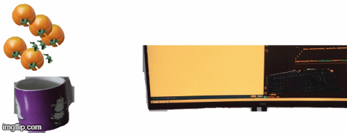
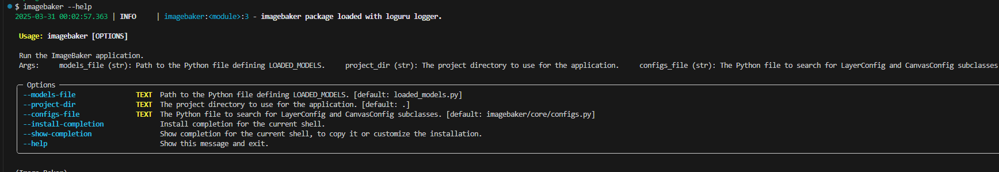
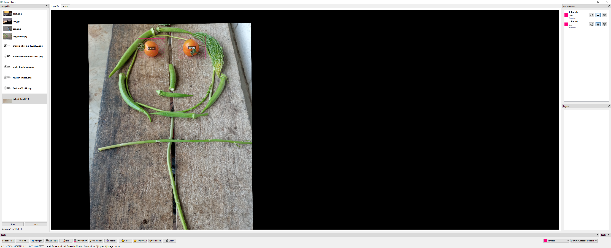
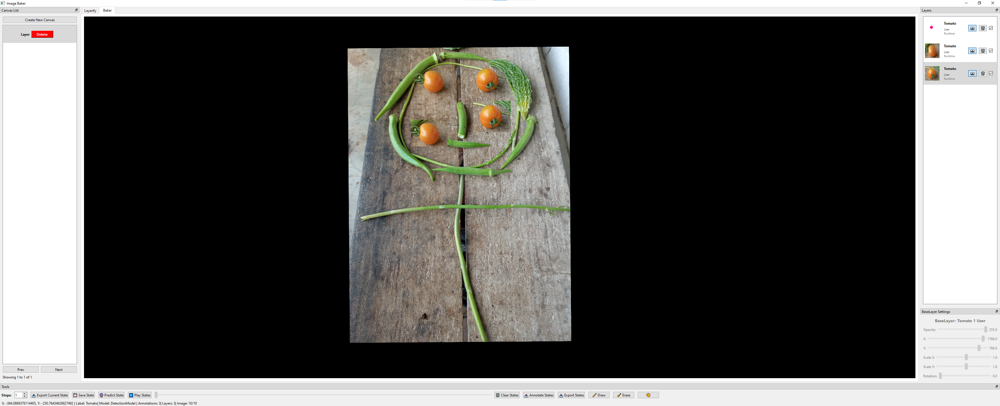
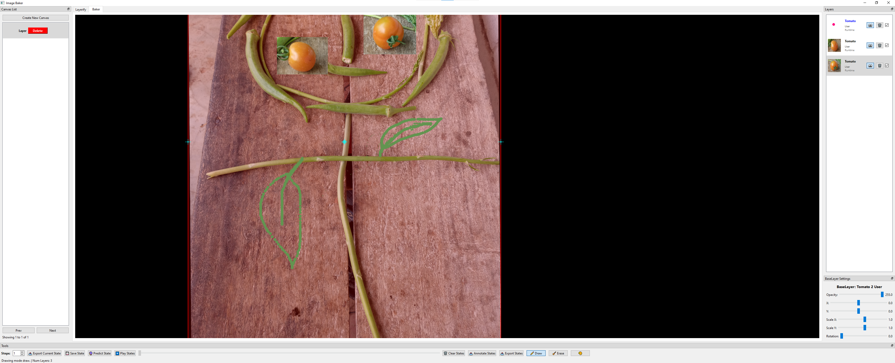
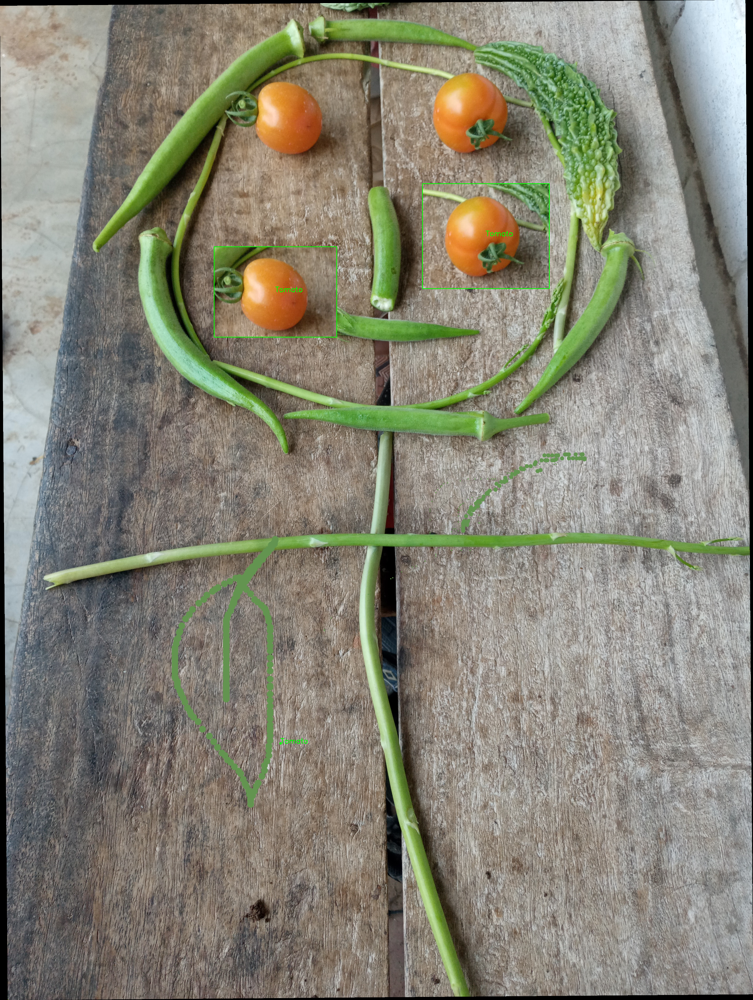

# Image-Baker


<!--  -->

[](https://pypi.org/project/imagebaker/)

<p align="center">
    
</p>


*An example of baked images. (Each object is a layer and an annotation will also be extracted for all layers.)*

Let's bake an image.

## Why is it relevant?

When training computer vision models (especially for detection and segmentation), labeling large amounts of data is crucial for better model performance. Often, the process involves multiple cycles of labeling, training, and evaluation. By generating multiple realistic labeled datasets from a single image, the time spent on labeling can be significantly reduced.

## What's up with the name?
The concept involves extracting portions of an image (e.g., objects of interest) using tools like polygons or models such as Segment Anything. These extractions are treated as layers, which can then be copied, pasted, and manipulated to create multiple instances of the desired object. By combining these layers step by step, a new labeled image with annotations in JSON format is created. The term "baking" refers to the process of merging these layers into a single cohesive image.

## Getting Started
### Installation
#### Using PIP
This project is also available on the PyPI server.

```bash
pip install imagebaker

# Install with model extras (YOLO, RF-DETR, SAM 2, PyTorch)
pip install "imagebaker[all]"

# Or install specific model extras:
pip install "imagebaker[yolo]"
pip install "imagebaker[rfdetr]"
pip install "imagebaker[sam2]"
```

#### Developing
Please, clone this repository and install it locally:

```bash
git clone https://github.com/q-viper/image-baker.git 
cd image-baker
pip install -e .
```

### First Run
Launch the desktop GUI:

```bash
imagebaker --models-file examples/loaded_models.py
```

Or launch the standalone Web version:

```bash
imagebaker web --port 8000 --models-file examples/loaded_models.py

# Launch web server in debug mode (verbose logging and live debug indicators)
imagebaker web --debug
# Or: imagebaker web -d
# Or: imagebaker web debug
```

For more options, please do: `imagebaker --help` It should give the following options.




* **`--configs-file`** allows us to define custom configs. The custom configs have to inherit LayerConfig and CanvasConfig defined at [imagebaker/core/configs/configs.py](https://github.com/q-viper/image-baker/blob/main/imagebaker/core/configs/configs.py). An example is available at [examples](https://github.com/q-viper/image-baker/blob/main/examples/). 

After cloning and going to the project directory, the following code should work.
`imagebaker --models-file examples/loaded_models.py --configs-file examples/example_config.py`

## Features
- **Cross-Platform**: Run as a desktop application (PySide6 Qt) or as a modern browser-based web application (`imagebaker web`).
- **Annotating Images**: Load images and annotate with bounding boxes, points, and polygons. Mode-specific mouse cursor indicators.
- **Model Support**: Integrate with YOLO (detection & segmentation), RF-DETR (detection & instance segmentation), and SAM 2 (prompt-guided segmentation) via `imagebaker[all]`.
- **Annotation Formats**: Export and import annotations directly in **COCO**, **YOLO**, and ImageBaker **JSON** formats.
- **Layerifying**: Crop images based on annotations to create reusable layers with a single click ("Layerify All").
- **Baking States & Caching**: Arrange layers by dragging, rotating, scaling, adjusting opacity, and drawing. Caching is persistent across sessions for both Layerify and Baker tabs with direct state download prompts.
- **Dataset Generation**: Extract reproducible train/val/test splits (`CacheDatasetGenerator`) with background isolation (zero background data leakage across splits), aspect-ratio preserving resizing, optional cropping, layer min/max bounds, and selective unlabeled noise layers.
- **On-the-Fly PyTorch Dataset**: Synthesize training samples dynamically during training via `ImageBakerTorchDataset`.
- **Playing States**: Replay saved states, export them locally, or use them for further predictions.
- **Exporting States**: Export the final annotated JSON and the baked multilayer image.
- **Drawing On Layers**: First select a layer then draw upon it. Only selected layer will be drawn. And if no layers are selected, then the drawing will not be exported.

### Shortcuts
* **Ctrl + C**: Copy selected annotation/layer.
* **Ctrl + V**: Paste copied annotation/layer in its parent image/layer if it is currently open.
* **Delete**: Delete selected annotation/layer.
* **Left Click**: Select an annotation/layer on mouse position.
* **Left Click + Drag**: Drag a selected annotation/layer.
* **Double Left Click**: When using polygon annotation, completes the polygon.
* **Right Click**: Unselect an annotation/layer. While annotating the polygon, undo the last point.
* **Ctrl + Mouse Wheel**: Zoom In/Out on the mouse position, i.e., resize the viewport.
* **Ctrl + Drag**: If done on the background, the viewport is panned.
* **Ctrl + S**: Save State on Baker Tab.
* **Ctrl + D**: Draw Mode on Baker Tab. Drawing can happen on a selected or main layer.
* **Ctrl + E**: Erase Mode on Baker Tab.
* **Ctrl + H**: Opens a help window.
* **Wheel**: Change the size of the drawing pointer.
* **Q**: Point mode on annotation.
* **W**: Polygon mode on annotation. Moves selected layer one step up in layer lists in baker.
* **S**: Moves selected layer one step down in layer list in baker.
* **E**: Rectangle mode on annotation.
* **H**: Hides/un-hides selected annotation/layer.
* **L**: Creates layer from an annotation. If any annotation selected, creates only its, else creates layers from all visible annotations.
* **C**: If any annotation is selected, a input box for Caption is created. It can be edited on baker tab as well and is state aware.
* **Numerics**: Selecting number 1, 2, till 9 selects label. If not available, asks for a new label.
* **Escape**: Closes the application.

## Demo
### Annotation Page
This is where the loading of the image folder and annotation, connection with the model running in the backend, and layerifying happen.



### Baker Page
This is where the layer baking happens. And the extraction of the layers as well.



An example of drawing:



### Annotated

The JSON and the baked image will be exported to the local folder, and in debug mode, the annotations and the mask for each layer will be exported too.



### Demo Video

To see the tool in action, check out the demo video below:


[](https://youtu.be/WckMT0r-2Lc)


Click on the image above to play the video on YouTube.


## Contributions


Contributions are welcome! 

Do you find this project to be useful and are you looking for some features that are not implemented yet? Feel free to open issues or submit pull requests to improve the project.

For more please visit [CONTRIBUTING](https://github.com/q-viper/image-baker/blob/main/CONTRIBUTING).